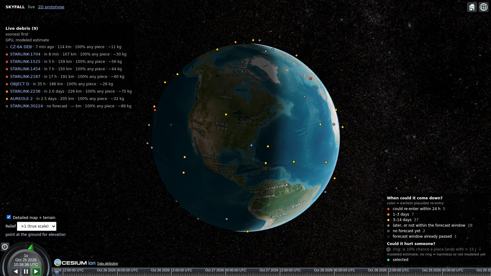
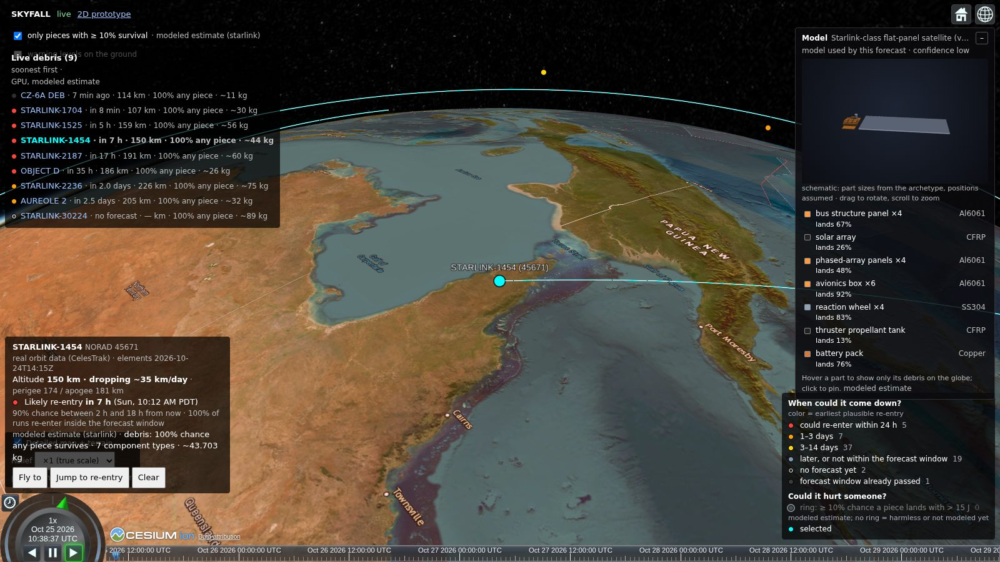
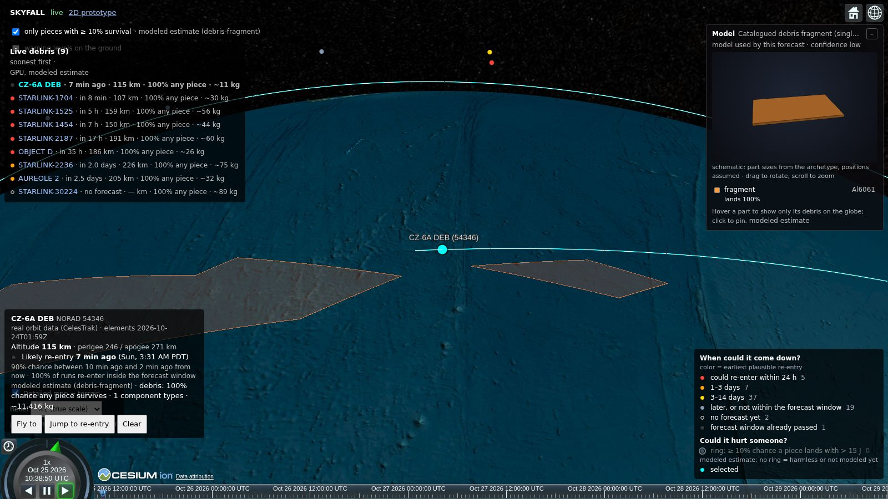
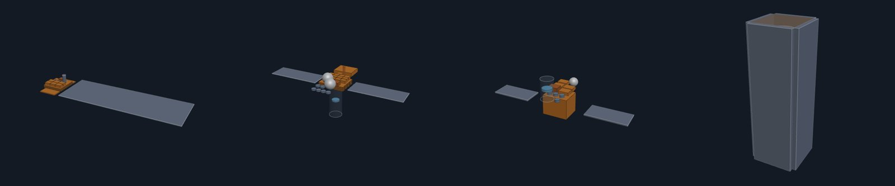
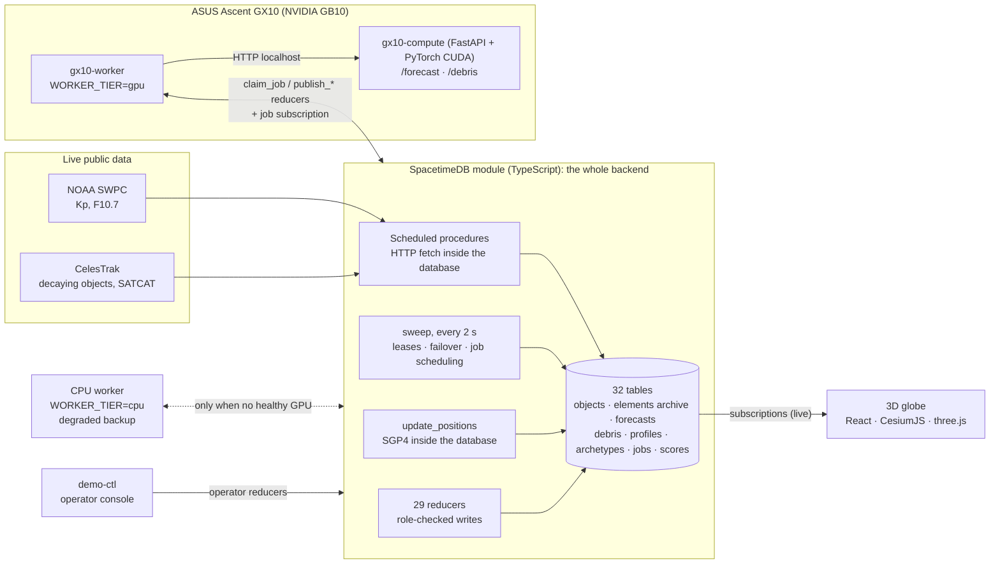
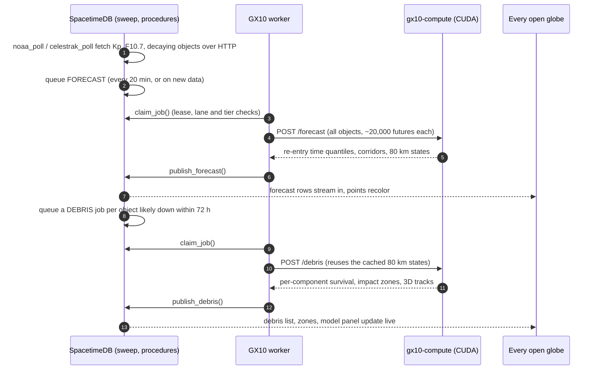

# SKYFALL

**Live prediction of what survives when satellites come down: which pieces, how heavy, how dangerous, and where they land, streamed to a 3D globe.**



Low Earth orbit now holds thousands of satellites with short lifetimes. Starlink alone de-orbits satellites almost daily, and rocket stages and old debris come down as well. Most of that mass burns up, but not all of it: tanks, reaction wheels and engine parts have been found on the ground. The public sees at most an orbit dot and a re-entry window. Break-up and survivability analyses stay inside operators and space agencies.

SKYFALL runs that analysis openly and continuously, on live public data:

1. **Track** every object that is decaying, from live orbit data.
2. **Forecast** when and where each one re-enters, as a probability distribution, from tens of thousands of simulated futures per object.
3. **Break it up**: split each object into its components (bus, arrays, tanks, wheels, batteries) and fly every piece down through the atmosphere with heating and melting, thousands of times.
4. **Show** which pieces survive, their mass and impact energy, and the ground zones where they could land, live on a 3D globe.

The physics runs on our own **ASUS Ascent GX10** (NVIDIA GB10). **SpacetimeDB** is the entire backend: it fetches the live data itself, schedules and chains the GPU jobs, fails over to a CPU worker, keeps the archive, scores past forecasts and streams every result to every screen in real time.

> Every debris number on screen is a **modeled estimate** from public data and documented component lists, not an operator's internal assessment. See [What is real, modeled and assumed](#what-is-real-modeled-and-assumed).

---

## Contents
- [What it shows](#what-it-shows)
- [Architecture](#architecture)
- [SpacetimeDB is the backend](#spacetimedb-is-the-backend)
- [The prediction engine](#the-prediction-engine)
- [Debris and survivability model](#debris-and-survivability-model)
- [GPU compute on the ASUS GX10](#gpu-compute-on-the-asus-gx10)
- [The 3D globe](#the-3d-globe)
- [Tech stack](#tech-stack)
- [How we built it: Cursor and Grok](#how-we-built-it-cursor-and-grok)
- [What is real, modeled and assumed](#what-is-real-modeled-and-assumed)
- [Run it](#run-it)
- [Repo map](#repo-map)
- [Limits](#limits)

---

## What it shows

| | |
|---|---|
|  | **One object, broken down.** Select a satellite to see its live altitude, its drop rate, and the 90% window for re-entry. The model panel shows the components the debris simulation used and the chance that each one reaches the ground. Hover a part and the globe shows only that part's debris. |
|  | **Where the pieces land.** Impact zones (50% and 90%) for the surviving pieces are drawn on the ground. They are computed from thousands of simulated descents, not a single guess. |

Point colors on the globe show the **earliest plausible re-entry** (the 5th percentile of the forecast), so anything that *could* come down within a day stands out. A ring marks objects with at least a 10% chance that a piece lands with more than 15 J of energy, the usual threshold for a dangerous fragment.

**Satellite models.** Each object is matched to a documented component list (an "archetype"). Nine are defined so far: Starlink-class, generic smallsat, 3U and 6U CubeSats, microsat, large satellite, cargo vehicle, rocket upper stage, and debris fragment. Each part has its material, shape, mass and size, with sources. The viewer draws them as interactive 3D schematics:



---

## Architecture



Only SpacetimeDB holds state. The workers are stateless: kill one mid-job and the database re-queues the job and someone else finishes it. The compute service never talks to the database. Screens never talk to a feed or to the GPU. Every rule that coordinates the system lives in a reducer.

### One forecast cycle



Unplug the GX10 and its heartbeat stops. Within 10 s `sweep` marks it unhealthy and re-queues its job. `claim_job` then hands work to the CPU worker, which runs a labeled **degraded mode** with fewer samples and wider zones. Measured on maincloud: the next job was finished by the CPU worker **7 s** after the GPU worker was killed.

Full table, reducer and procedure reference: [docs/ARCHITECTURE.md](docs/ARCHITECTURE.md).

---

## SpacetimeDB is the backend

SKYFALL has no other server, no side database and no message queue. The module in [`spacetimedb/src/index.ts`](spacetimedb/src/index.ts) (about 2,400 lines of TypeScript) **is** the backend. Everything else is a thin client that subscribes to tables and calls reducers.

| What the system needs | How SpacetimeDB does it |
|---|---|
| **Live data ingestion** | Scheduled **procedures** make HTTP calls from inside the database: NOAA space weather every 15 min, CelesTrak decaying objects every 2 h, CelesTrak SATCAT decay dates every 6 h. Politeness limits (no retry loops, per-id cooldowns) are enforced in the module. |
| **A GPU job queue with leases** | `compute_job` + `claim_job` / `publish_forecast` / `publish_debris` / `fail_job`. Each worker gets two lanes (one bulk job, one fast job), with lease expiry, 3 retries, and oldest-first ordering. |
| **Job chaining** | `publish_forecast` itself queues a DEBRIS job for every object with at least a 20% chance of re-entering within 72 h, at most one queued per object. The pipeline runs forecast → debris with no orchestrator. |
| **GPU → CPU failover** | `claim_job` refuses CPU workers while a healthy GPU worker exists. The `sweep` scheduled reducer (every 2 s) expires leases, marks silent workers unhealthy, re-queues their jobs, and queues a live forecast if none has run for 20 min. |
| **Orbit propagation in the database** | `update_positions` runs SGP4 (satellite.js) inside the module and refreshes each object's current position every 60 s, or every 5 s within an hour of its forecast re-entry. |
| **Access control** | `worker_registry` + role checks in every reducer: workers must be approved by the operator, scheduled reducers reject outside callers, and a second worker with the same identity is refused by the lease check. |
| **Archive and replay** | `elements_history` (every distinct element set), `forecast_history`, `debris_history`, `compute_run`. Historical re-entries load as replay cases and are forecast "as of" a past time. |
| **Self-scoring** | `reentry_outcome` + `forecast_score`: when an official decay time arrives, the module scores the last forecast made before it (hours of error, inside the 5–95% window or not, lead time). |
| **Real-time sync** | The globe subscribes to forecasts, debris results, 3D tracks, positions and scores. A new GPU result appears on every open screen with no polling and no API layer. Measured earlier in the build: a new input to a new corridor on screen in **0.39 s**. |

**In numbers:** 32 tables, 29 reducers, 4 procedures, 6 schedules. The live database holds 72 tracked objects, 1,600+ archived forecasts, and 230+ GPU jobs run through the queue so far.

---

## The prediction engine

Re-entry prediction is a statistical estimation problem. Public orbit data is uncertain by kilometres, upper-atmosphere density changes with solar activity, and each object's drag is unknown. SKYFALL learns what it can from the data and carries the rest as uncertainty ([`services/gx10-compute/sim.py`](services/gx10-compute/sim.py), spec in [docs/SIM_SPEC.md](docs/SIM_SPEC.md)):

- **Fitted per object.** Each object's ballistic coefficient is calibrated so that the simulated decay rate matches the decay actually observed in its orbital elements (`MEAN_MOTION_DOT`). Objects decay at their own observed rate, not at a catalog guess.
- **Monte Carlo ensemble.** About 20,000 sampled futures per object, perturbed in drag (log-normal, widened when the geomagnetic Kp index is high) and in position (along-track error growing with the age of the elements).
- **Physics.** SGP4 initial state, then two-body + J2 + drag against a co-rotating atmosphere, RK4 integration, with the NRLMSIS 2.1 atmosphere driven by live F10.7 and Ap.
- **Output is a distribution, never a point.** Re-entry time quantiles (5/25/50/75/95%), the share of futures that re-enter within the horizon, and ground corridors.
- **Bayesian updating.** Ground observations are fused with a robust likelihood (time and distance error plus an outlier floor). When the particle weights collapse, the engine refits its proposal and redraws (adaptive importance sampling), so corridors narrow from evidence.
- **Validated against reality.** Forecasts are scored automatically against official decay times as they arrive (see `forecast_score`).

## Debris and survivability model

For every object likely to come down soon, `/debris` ([`services/gx10-compute/debris.py`](services/gx10-compute/debris.py), spec in [docs/DEBRIS_MODEL.md](docs/DEBRIS_MODEL.md)):

1. Takes the forecast's states at 80 km (start of break-up) for each sampled future.
2. Splits the object into its archetype's components (material, shape, mass, size, count).
3. Flies every (future × component) to the ground on the GPU as a batched tensor: 3-DOF flight, drag, Sutton–Graves stagnation heating, radiative cooling, lumped-mass heating and melting with the material's heat capacity and heat of fusion.
4. Returns, per component: survival probability, mean surviving mass, impact speed and energy, demise altitude, and 50%/90% impact zones. A few representative 3D trajectories are returned for the animation.

The physics knows seven materials: aluminium 6061, Ti-6Al-4V, stainless 304, CFRP, glass, copper and Inconel. This is a reduced version of the "object-oriented" approach used by NASA DAS and ESA DRAMA, and it is labeled as such everywhere it appears.

---

## GPU compute on the ASUS GX10

All forecast and debris physics runs as batched PyTorch CUDA kernels on an **ASUS Ascent GX10** (NVIDIA GB10 Grace Blackwell) on our desk. From the live database's `compute_run` table:

| | GX10 (CUDA) | CPU fallback |
|---|---|---|
| Forecast runs | 23 | 1 |
| Sampled futures simulated | **32.7 million** | 21,300 |
| Integration steps (particle × step) | **752 billion** | 169 million |
| Largest single run | 71 objects × 20,000 futures = 1.42 M particles, 62.8 B steps, 13 min | 71 objects × 300 futures, 75 s |
| Throughput | **~48 M particle-steps / s** | ~2.2 M particle-steps / s (**~22× slower**) |
| Debris runs | 196 (2,000 futures × every component each) | degraded: 100 futures, 3 components |

The GPU is what makes it practical to run tens of thousands of futures for every decaying object every 20 minutes, and then a full break-up simulation for each object about to come down. The CPU path exists to keep the system alive, visibly degraded, when the GX10 is offline.

---

## The 3D globe

`web/` is a React + CesiumJS app subscribed to the database.

- **Detailed map:** city-level imagery, 3D terrain with relief exaggeration, and a ground-elevation readout. Polar caps are filled and color-matched to the imagery.
- **Point colors** by earliest plausible re-entry, a danger ring, and a legend with live counts and click-to-filter.
- **Selected object:** live altitude, perigee/apogee, drop rate (km/day), the re-entry window, and the trajectory.
- **Debris layers:** falling-piece tracks, impact zones by component, warning levels on a ground grid, and a filter for pieces that survive at least 10% of the time.
- **3D model viewer** (three.js, loaded on demand): the archetype as an interactive schematic. Hover or click a part to isolate its debris on the globe.
- **Camera:** pivots around Earth's centre, the ground point, or the selected satellite, and keeps spinning after a flick, easing to a stop.

---

## Tech stack

| Layer | Technology |
|---|---|
| Backend, state, scheduling, sync | **SpacetimeDB 2.13** (TypeScript module, maincloud), satellite.js 6 (SGP4 in-module) |
| GPU physics | Python, **PyTorch (CUDA 13)**, FastAPI, NumPy, SciPy, scikit-image (contours), `sgp4`, `pymsis` (NRLMSIS 2.1) |
| Hardware | **ASUS Ascent GX10**, NVIDIA GB10 Grace Blackwell |
| Worker | Node + TypeScript, SpacetimeDB TypeScript SDK |
| Frontend | React 19, **CesiumJS 1.146**, three.js, satellite.js 7, Vite 8, TypeScript 5.9 |
| Data | CelesTrak (GP elements, SATCAT), NOAA SWPC (Kp, F10.7), public component and material references (cited per archetype) |
| Build tools | **Cursor** (with Grok), Claude Code, GitHub PRs |

---

## How we built it: Cursor and Grok

- **Cursor** was a core coding agent. Its background agents opened branches directly against the repo (for example `cursor/bench-forecast-vs-grok-*`, which fixed the forecast result fields and added [`bench_forecast.py`](services/gx10-compute/bench_forecast.py) to time the forecast engine on the GX10).
- **Grok** (Grok 4.7 inside Cursor) built the forecast validation in the SpacetimeDB module: `reentry_outcome`, the SATCAT decay fetch, `forecast_score`, and the historical replay loader. It also kept the Space-Track path disabled when no credentials are present. Log: [docs/TOOL_LOG.md](docs/TOOL_LOG.md).
- **Planned:** a Grok assistant inside the app, answering questions like "what's coming down near me, and does any of it survive?" from the live tables. The reducers and table are specified (`ask_assistant`, `post_answer`, `assistant_message`, with the ASK job kind in the same queue), but it is not built yet.

---

## What is real, modeled and assumed

| Part | Status |
|---|---|
| Orbit elements of decaying objects (CelesTrak), space weather (NOAA SWPC) | **Real, live**, fetched by the database |
| Official decay dates (CelesTrak SATCAT) | **Real**, used to score forecasts |
| Re-entry time and place | **Modeled:** Monte Carlo, J2 + drag, NRLMSIS 2.1, drag calibrated to the observed decay |
| Component lists per satellite class | **Assumed** from public sources, cited in each `data/archetypes/*.json` file, with a confidence rating |
| Break-up, heating, survival, impact zones | **Modeled:** lumped-mass heating, 3-DOF flight |
| Satellite model positions in the 3D viewer | **Schematic:** part sizes come from the archetype; placement is assumed |

---

## Run it

```bash
# 1. Database (SpacetimeDB CLI)
cd spacetimedb && npm install
spacetime publish skyfall-calhacks --server maincloud --module-path .

# 2. GPU compute on the GX10 (USE_GPU=0 for the labeled CPU mode)
cd services/gx10-compute && pip install -r requirements.txt   # + torch for CUDA 13
uvicorn app:app --host 127.0.0.1 --port 8000

# 3. Worker (prints its identity; the operator approves it)
cd services/gx10-bridge && npm ci && WORKER_TIER=gpu npm start

# 4. Operator console
cd tools/demo-ctl && npm ci
npm start -- approve <worker-identity-hex>
npm start -- seed-archetypes   # loads data/archetypes and re-matches every object
npm start -- status

# 5. Globe
cd web && npm ci && npm run dev
```

Details, accounts and environment variables: [docs/SETUP.md](docs/SETUP.md), [docs/GX10_SETUP.md](docs/GX10_SETUP.md), [`.env.example`](.env.example).

## Repo map

| Path | What |
|---|---|
| `spacetimedb/` | The backend: tables, reducers, scheduled procedures |
| `services/gx10-compute/` | GPU physics: `sim.py` (forecast), `debris.py` (break-up and survival), `app.py` (`/forecast`, `/debris`), tests |
| `services/gx10-bridge/` | Stateless worker (`WORKER_TIER=gpu\|cpu`) |
| `web/` | 3D globe |
| `tools/demo-ctl/` | Operator console: approve workers, seed archetypes, queue jobs, load replay cases |
| `data/archetypes/`, `data/materials.json` | Component and material assumptions, with sources |
| `data/replay/` | Historical re-entry cases for validation |
| `docs/` | Architecture, physics specs, data sources, setup |

## Limits

- Public orbit data is accurate to about a kilometre, and re-entry timing is uncertain by hours even a day or two out. SKYFALL shows distributions and zones, never pinpoints.
- We don't know any operator's internal design. Archetypes are generic and sourced, and results can be wrong for a specific satellite.
- Simplified physics: the atmosphere is averaged over latitude and local time, F10.7 and Kp are held constant over a forecast, break-up starts at 80 km, there are no winds, and heating is averaged over tumbling.
- `/debris` is on the DEBRIS job flow: `publish_forecast` queues objects likely to re-enter within 72 hours, and `request_debris` queues one object now. The worker calls `/debris` and `publish_debris` streams the result. Spheres, cylinders, boxes and plates are flown (boxes and plates use a tumbling-average area). CUDA is required unless `USE_GPU=0`, the labeled CPU fallback. The globe shows **DEBRIS MOCK** until a result exists. Steps: [docs/DEMO_RUNBOOK.md](docs/DEMO_RUNBOOK.md).
